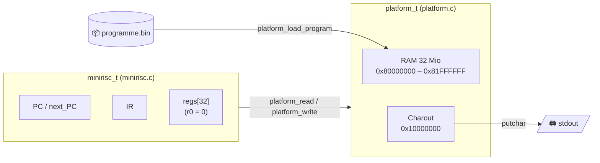

<div align="center">

# 🖥️ MiniRISC — Émulateur de processeur

**Un émulateur en C d'un processeur RISC 32 bits (inspiré du RISC-V RV32IM)**
*Projet du cours Architecture des Ordinateurs — ENSTA*


-orange)


[Présentation](#-présentation) •
[Architecture](#-architecture) •
[Compiler et lancer](#-compiler-et-lancer) •
[Feuille de route](#-feuille-de-route) •
[ISA](#-jeu-dinstructions-isa) •
[Journal de bord](#-journal-de-bord)

</div>

---

## 📖 Présentation

L'objectif du projet est **d'écrire, en C, un programme qui se comporte comme un processeur**.
Il prend en entrée un binaire compilé pour l'architecture **MiniRISC**, le charge dans une RAM simulée, puis exécute les instructions une par une, exactement comme le ferait un vrai processeur :

```
   ┌────────┐     ┌──────────────────┐     ┌──────────────┐
   │ fetch  │ ──▶ │ décodage +       │ ──▶ │ mise à jour  │ ──┐
   │        │     │ exécution        │     │ du PC        │   │
   └────────┘     └──────────────────┘     └──────────────┘   │
        ▲                                                      │
        └─────────────── jusqu'à l'instruction `ebreak` ◀─────┘
```

Le MiniRISC est **très proche du RISC-V RV32IM** (mêmes instructions, mêmes registres), mais utilise un **encodage binaire qui lui est propre**. C'est pourquoi on utilise une chaîne de compilation dédiée (`riscv32-MINIRISC-elf-gcc`) pour compiler les programmes de test.

Pour valider notre émulateur, on dispose de la **`gold_vm`** : une machine virtuelle de référence (fournie par l'enseignant, code obfusqué) qui fonctionne déjà. Si notre émulateur produit la même sortie que la `gold_vm`, on est sur la bonne voie ✅.

---

## 🧱 Architecture



### Carte mémoire

| Adresse                     | Périphérique | Description                                                     |
|-----------------------------|--------------|-----------------------------------------------------------------|
| `0x10000000`                | Charout      | Écrire un octet à cette adresse affiche le caractère dans le terminal |
| `0x10000004` *(gold_vm)*    | Charout      | Affiche un entier (à confirmer)                                 |
| `0x10000008` *(gold_vm)*    | Charout      | Affiche une valeur en hexadécimal (à confirmer)                 |
| `0x80000000` – `0x81FFFFFF` | RAM          | 32 Mio — le programme est chargé au début, le PC initial pointe ici |

### Organisation du dépôt

```
.
├── minirisc/        🧠 NOTRE émulateur (c'est ici qu'on travaille)
│   ├── main.c       → point d'entrée : crée la plateforme + le CPU, charge et exécute
│   ├── platform.c/h → mémoire (RAM) et périphériques (charout)
│   └── minirisc.c/h → le processeur : fetch / decode / execute
├── gold_vm/         🏆 VM de référence (ne pas modifier) — sert de « corrigé »
├── asm_test_1/      🧪 test en assembleur : affiche deux chaînes
└── c_test_1/        🧪 test en C : put_string, printf et math (newlib)
    ├── minirisc.ld       → script d'édition de liens (RAM à 0x80000000, pile, tas)
    ├── minirisc_init.S   → initialise sp, appelle _start puis termine par ebreak
    └── syscalls.c        → _write, _sbrk, _exit… pour faire fonctionner la newlib
```

---

## 🚀 Compiler et lancer

### Prérequis

- `gcc` et `make`
- Chaîne de compilation MiniRISC installée dans `/opt/gcc_MINIRISC/bin` (doit être dans le `PATH`)

```bash
export PATH=/opt/gcc_MINIRISC/bin:$PATH
```

### Compiler l'émulateur

```bash
make -C minirisc            # produit minirisc/build/minirisc
```

### Lancer un test

```bash
cd asm_test_1               # ou c_test_1
make                        # compile le programme → build/esw.bin
make exec                   # exécute sur NOTRE émulateur
make test                   # exécute sur la gold_vm (résultat attendu)
make lss                    # affiche le désassemblage
```

<details>
<summary>📺 <b>Sortie attendue de <code>asm_test_1</code> (gold_vm)</b></summary>

```
Loaded 84 bytes in memory.
Hello, World!
What's up?

executed 140 instructions
```
</details>

<details>
<summary>🐞 <b>Déboguer avec gdb</b></summary>

```bash
make -C minirisc gdb        # ouvre gdb en mode TUI
(gdb) run ../asm_test_1/build/esw.bin
```
</details>

---

## 🗺️ Feuille de route

> 💡 **Mode d'emploi :** quand une tâche est terminée, remplacez `- [ ]` par `- [x]` et mettez à jour le badge de progression en haut de la page.

### ✅ Étape 0 — Mise en place
- [x] Structure du projet, Makefiles et tests fournis
- [x] VM de référence (`gold_vm`) qui compile et exécute les tests
- [x] Chaîne de compilation `riscv32-MINIRISC-elf` installée

### ✅ Étape 1 — Plateforme (`platform.c`)
- [x] `platform_new` / `platform_free` — allocation de la RAM de 32 Mio
- [x] `platform_load_program` — copie le binaire à l'adresse `0x80000000`
- [x] `platform_read` — lectures 8/16/32 bits, little-endian
- [x] `platform_write` — écritures partielles avec masque
- [x] Vérification de l'alignement et des accès hors RAM
- [x] Périphérique **charout** à `0x10000000`
- [ ] Renvoyer les codes `PLATFORM_MISALIGNED_ACCESS` / `PLATFORM_ACCESS_FAULT` au lieu de `-1`
- [ ] Charout complet (`0x10000004` et `0x10000008`, comme dans la gold_vm)

### 🟡 Étape 2 — Squelette du processeur (`minirisc.c`)
- [x] `minirisc_new` / `minirisc_free`
- [x] `minirisc_fetch` — lit l'instruction pointée par `PC` dans `IR`
- [x] Boucle principale `minirisc_run` (fetch → decode/execute → PC)
- [x] Extraction de l'opcode (`IR & 0x7f`) et `r0` toujours à zéro
- [ ] ⚠️ **Corriger `ebreak`** : en MiniRISC il est encodé `0x00000027` (opcode **39**), et non `0x00100073` comme en RISC-V standard
- [ ] Extraction des champs `rd`, `rs1`, `rs2` et des immédiats

### ⬜ Étape 3 — Instructions RV32I
- [ ] `LUI`, `AUIPC`
- [ ] Sauts : `JAL`, `JALR`
- [ ] Branchements : `BEQ`, `BNE`, `BLT`, `BGE`, `BLTU`, `BGEU`
- [ ] Chargements : `LB`, `LH`, `LW`, `LBU`, `LHU`
- [ ] Rangements : `SB`, `SH`, `SW`
- [ ] UAL avec immédiat : `ADDI`, `SLTI`, `SLTIU`, `XORI`, `ORI`, `ANDI`, `SLLI`, `SRLI`, `SRAI`
- [ ] UAL registre-registre : `ADD`, `SUB`, `SLL`, `SLT`, `SLTU`, `XOR`, `SRL`, `SRA`, `OR`, `AND`
- [ ] Système : `ECALL`, `EBREAK`
- [ ] 🎯 **Jalon :** `asm_test_1` affiche les deux chaînes comme la gold_vm

### ⬜ Étape 4 — Extension M (multiplication/division)
- [ ] `MUL`, `MULH`, `MULHSU`, `MULHU`
- [ ] `DIV`, `DIVU`, `REM`, `REMU` (y compris division par zéro et dépassement)
- [ ] 🎯 **Jalon :** `c_test_1` (printf + `M_PI`) fonctionne comme sur la gold_vm

### ⬜ Étape 5 — Validation et bonus
- [ ] Compteur d'instructions exécutées (comme la gold_vm)
- [ ] Nos propres programmes de test (un par groupe d'instructions)
- [ ] Script qui compare automatiquement la sortie de notre émulateur à celle de la gold_vm
- [ ] Mode *trace/debug* (afficher PC, instruction et registres à chaque pas)
- [ ] *(bonus)* mesurer les performances (instructions/seconde)

---

## 📚 Jeu d'instructions (ISA)

> ⚠️ L'encodage **n'est pas celui du RISC-V standard**. Le tableau ci-dessous a été déduit de la `gold_vm` et du désassemblage de la chaîne de compilation — à vérifier avec l'énoncé.

<details>
<summary><b>🔢 Format des champs</b></summary>

| Champ                 | Bits                       | Extraction (en C)                             |
|-----------------------|----------------------------|-----------------------------------------------|
| `opcode`              | `[6:0]`                    | `IR & 0x7f`                                   |
| `rd`                  | `[11:7]`                   | `(IR >> 7) & 0x1f`                            |
| `rs1`                 | `[16:12]`                  | `(IR >> 12) & 0x1f`                           |
| `rs2`                 | `[21:17]`                  | `(IR >> 17) & 0x1f`                           |
| imm (type I)          | `[31:20]` signé            | `(int32_t)IR >> 20`                           |
| imm (type U)          | `[31:12]`                  | `IR & 0xfffff000`                             |
| décalage `JAL`        | `[31:12]` signé            | `((int32_t)IR >> 11) & ~1`                    |
| décalage branchement  | `[31:19]` signé            | `((int32_t)IR >> 19) & ~1`                    |

Pour les **rangements** et les **branchements**, le second registre source se trouve dans le champ `[11:7]` (à la place de `rd`).

</details>

<details>
<summary><b>📋 Table des opcodes</b></summary>

| Opcode | Instruction | Opcode | Instruction | Opcode | Instruction |
|:------:|-------------|:------:|-------------|:------:|-------------|
| 1  | `LUI`   | 18 | `SW`    | 33 | `SLT`    |
| 2  | `AUIPC` | 19 | `ADDI`  | 34 | `SLTU`   |
| 3  | `JAL`   | 20 | `SLTI`  | 35 | `XOR`    |
| 4  | `JALR`  | 21 | `SLTIU` | 36 | `OR`     |
| 5  | `BEQ`   | 22 | `XORI`  | 37 | `AND`    |
| 6  | `BNE`   | 23 | `ORI`   | 38 | `ECALL`  |
| 7  | `BLT`   | 24 | `ANDI`  | 39 | `EBREAK` |
| 8  | `BGE`   | 25 | `SLLI`  | 56 | `MUL`    |
| 9  | `BLTU`  | 26 | `SRLI`  | 57 | `MULH`   |
| 10 | `BGEU`  | 27 | `SRAI`  | 58 | `MULHSU` |
| 11 | `LB`    | 28 | `ADD`   | 59 | `MULHU`  |
| 12 | `LH`    | 29 | `SUB`   | 60 | `DIV`    |
| 13 | `LW`    | 30 | `SLL`   | 61 | `DIVU`   |
| 14 | `LBU`   | 31 | `SRL`   | 62 | `REM`    |
| 15 | `LHU`   | 32 | `SRA`   | 63 | `REMU`   |
| 16 | `SB`    |    |         |    |          |
| 17 | `SH`    |    |         |    |          |

</details>

---

## 📓 Journal de bord

| Date | Commit | Réalisation |
|------|--------|-------------|
| 23/11/2026 | `68fc70d` | 🎬 Premier commit : structure, Makefiles, tests et gold_vm |
| 23/11/2026 | `23c1b2f` | 🔧 Commit de test sur `main.c` |
| 23/11/2026 | `ecba873` | 🧱 Plateforme complète (RAM, lecture/écriture, charout) + squelette du processeur (fetch, boucle principale, `ebreak`) |
| *prochainement* | | *Corriger `ebreak` et implémenter les premières instructions* |

---

## 🤝 Contribuer (pour l'équipe)

1. Créez une branche à partir de `main` : `git checkout -b feat/nom-de-la-tache`
2. Implémentez puis **comparez avec la gold_vm** (`make exec` vs `make test`)
3. Cochez la tâche dans la [feuille de route](#-feuille-de-route) et ajoutez une ligne au [journal de bord](#-journal-de-bord)
4. Ouvrez une Pull Request 🚀

---

<div align="center">
<sub>Fait avec ☕ et beaucoup de <code>segfault</code>s · ENSTA — Architecture des Ordinateurs</sub>
</div>
